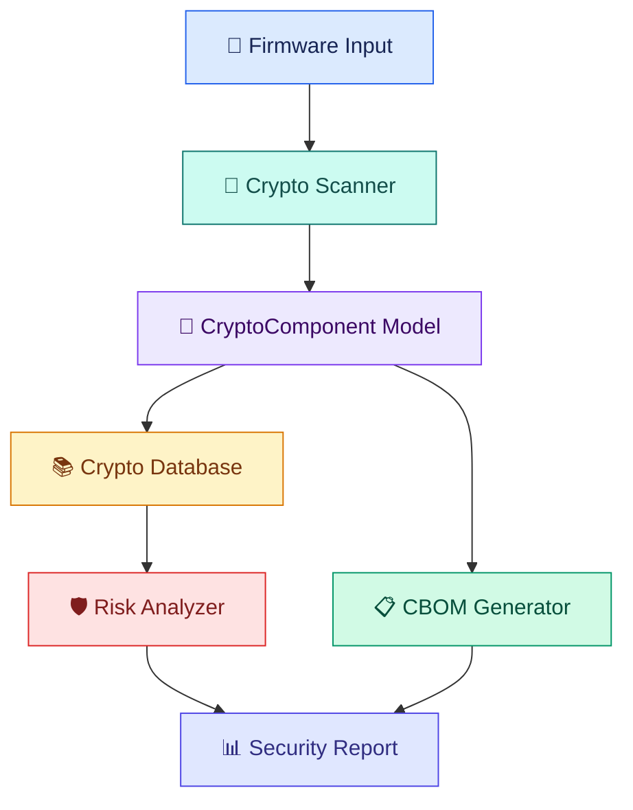

# 🛡️ FirmwareCBOM

### 🔐 Cryptographic Inventory & Risk Assessment for IoT Firmware

  

  
  
  
  

  <b>Discover cryptography. Build the inventory. Understand the risk.</b>

---

## 🌟 About the Project

**FirmwareCBOM** is a collaborative C++ project developed by a team of four students to explore cryptographic inventory and security assessment in Internet of Things (IoT) firmware.

IoT devices such as smart cameras, Wi-Fi routers, connected sensors, and smart locks rely on firmware to control their operations. Their software may use cryptographic algorithms to protect data, verify identities, and secure communications.

However, identifying and tracking these cryptographic components can become difficult when documentation is incomplete or security requirements change.

FirmwareCBOM aims to address this challenge by developing an object-oriented framework that identifies recognizable cryptographic references in supported firmware-related source files, organizes detected components into a **Cryptographic Bill of Materials (CBOM)**, and assesses potential security risks using documented rules.

> 🚧 **Development status:** Early development. The initial C++ OOP prototype is working. Automated scanning, CBOM generation, and risk assessment remain under development.

## 🎯 The Problem We're Solving

Imagine maintaining hundreds of IoT devices without a reliable inventory of the cryptographic algorithms used in their firmware.

Developers may need to determine:

- 🔍 Which cryptographic algorithms are present?
- 📂 Where were those algorithms detected?
- ⚠️ Which components may require security review?
- 🔄 Which components might need replacement or migration?
- 🔐 How can the organization prepare for future cryptographic changes?

FirmwareCBOM aims to make this process more structured and easier to investigate.

## 💡 What Is a CBOM?

A **Cryptographic Bill of Materials (CBOM)** is an inventory of cryptographic components used by a software system.

| Component | Purpose |
|---|---|
| AES | Symmetric encryption |
| RSA | Public-key cryptographic operations |
| SHA-256 | Cryptographic hashing |
| Digital signatures | Authenticity and integrity verification |
| Cryptographic libraries | Reusable security implementations |

A CBOM records what is present. Additional analysis is needed to determine whether a component is appropriate for its particular use.

## ⚙️ Planned Features

| Feature | Description | Status |
|---|---|---|
| 🧩 OOP component model | Represent cryptographic components as C++ objects | 🟢 Implemented |
| 📁 Firmware file input | Read supported source and configuration files | ⚪ Planned |
| 🔎 Crypto scanner | Detect recognizable algorithm references | ⚪ Planned |
| 📋 CBOM generation | Create a structured component inventory | ⚪ Planned |
| 🛡️ Risk assessment | Apply documented security rules | ⚪ Planned |
| 💬 Recommendations | Highlight components requiring review | ⚪ Planned |
| ⚛️ PQC readiness | Explore post-quantum migration planning | 🔵 Future scope |
| 🧪 Experimental evaluation | Measure detection accuracy and false positives | 🔵 Future scope |

*Status reflects the current project stage and will be updated as features are implemented and tested.*

## 🏗️ Planned Architecture

**Important:** This is the intended architecture, not a diagram of fully implemented modules. The first version will focus on source-file analysis before any exploration of compiled firmware binaries.

## 💻 Technology Stack

  
  
  
  
  

- **Language:** C++
- **Paradigm:** Object-Oriented Programming
- **Compiler:** Clang / Apple Clang or another compatible compiler
- **Development environment:** Visual Studio Code
- **Version control:** Git and GitHub

## 📈 Current Progress

### ✅ Initial OOP Prototype

The initial prototype demonstrates a `CryptoComponent` class with:

- `algorithm` — stores the algorithm name.
- `type` — stores the component type.
- `keySize` — stores the key-size field.
- `display()` — prints the object's information.

The program creates three demonstration objects representing AES, RSA, and SHA-256 and successfully displays their attributes.

### 🗺️ Development Roadmap

- [x] Define the project problem and objectives.
- [x] Implement the initial `CryptoComponent` class.
- [x] Create and display AES, RSA, and SHA-256 objects.
- [ ] Improve the class design using constructors and encapsulation.
- [ ] Implement supported file input.
- [ ] Develop the initial cryptographic scanner.
- [ ] Generate a structured CBOM report.
- [ ] Implement and validate risk-assessment rules.
- [ ] Evaluate the prototype using controlled sample inputs.
- [ ] Explore compiled firmware analysis and PQC readiness.

## 👥 Team FirmwareCBOM

Built collaboratively by a team of four students.

| Member | Name | Responsibility |
|---|---|---|
| Member 1 | `Shivansh Prakash` | Core OOP design |
| Member 2 | `Harshil Sharma` | Firmware input and scanning |
| Member 3 | `Navneet Chauhan` | Cryptographic information and risk assessment |
| Member 4 | `Aditya Srivastava` | CBOM generation, testing and integration |

*Replace these placeholders with the actual team members and agreed responsibilities.*

## 🤝 Collaboration

We use GitHub to manage source code, track tasks, and document our progress.

Our intended workflow:

1. Create or select a task.
2. Implement the feature in a separate branch when appropriate.
3. Compile and test the changes.
4. Review and merge the changes.
5. Update documentation to reflect completed work.

We welcome constructive feedback and suggestions that help improve the design and implementation.

## 🔬 Future Research Directions

Potential extensions include:

- More robust source-level cryptographic detection.
- Evaluation against labelled sample inputs.
- False-positive and false-negative analysis.
- Cryptographic risk assessment based on usage and configuration.
- Exploration of binary firmware analysis.
- Post-quantum cryptography readiness and migration planning.

These directions will be pursued only as the implementation and evaluation develop.

## ⚠️ Disclaimer

FirmwareCBOM is an educational project under development. Its initial prototype is not a complete firmware security scanner and must not be treated as a security certification tool.

Recognizing an algorithm name in source code does not prove that the algorithm is actually used at runtime or that the system is secure or insecure. Reliable assessment requires consideration of implementation, configuration, usage, key management, and the relevant threat model.

---

  <b>🔐 FirmwareCBOM</b> 
  <i>Learn. Build. Analyze. Improve.</i>

